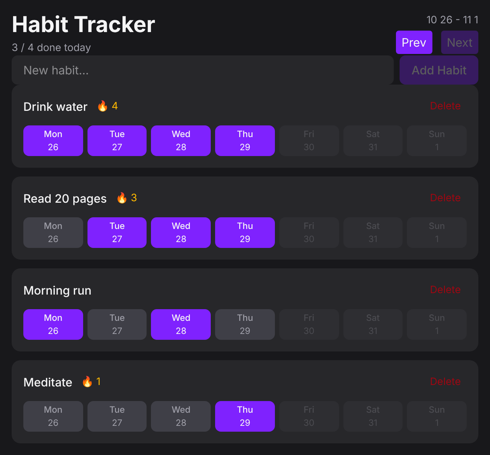

# Habit Tracker


A minimal habit tracker built with React 19, TypeScript and Tailwind CSS. Add habits, tick off the days you completed them on a weekly calendar and keep a streak going. Everything is stored in your browser, so there is no account and no backend to set up.

The repository also contains a mock REST API and a Postman collection with automated tests, built as an API testing exercise. The UI does not use that API. See [API testing with Postman](#api-testing-with-postman).



## Features

- Add habits and delete them. Empty or whitespace-only names are rejected.
- Weekly view (Monday to Sunday): click a day to mark a habit as done, click again to undo.
- Future days are disabled, so you can only log what has already happened.
- Browse earlier weeks with **Prev**. **Next** is disabled on the current week.
- 🔥 Streak counter: the number of consecutive days completed, counting back from today.
- Daily summary in the header, for example `3 / 4 done today`.
- Data is saved in `localStorage` (key `Habits`) and survives page reloads.
- Dark theme.

## Tech stack

| Area | Tools |
| --- | --- |
| UI | React 19 (hooks, Context API), React Compiler enabled |
| Language | TypeScript |
| Build tool | Vite 8 |
| Styling | Tailwind CSS 4, `tailwind-merge` |
| Dates | date-fns 4 |
| Code quality | ESLint 10 with typescript-eslint, React Hooks and React Refresh rules |
| API testing | Postman, Newman, json-server |

## Getting started

**Prerequisites:** Node.js `^20.19.0`, `^22.13.0` or `>=24` (the versions supported by both Vite 8 and ESLint 10) and npm.

```bash
git clone https://github.com/Anastasiia-Bakhareva/habbit_tracker_reactjs.git
cd habbit_tracker_reactjs
npm install
npm run dev
```

Then open <http://localhost:5173>.

| Script | Description |
| --- | --- |
| `npm run dev` | Start the Vite dev server with hot reload |
| `npm run build` | Type-check with `tsc -b` and create a production build in `dist/` |
| `npm run preview` | Serve the production build locally |
| `npm run lint` | Run ESLint |

## How it works

- **State:** `HabitProvider` (React Context) owns the list of habits and exposes `addHabit`, `deleteHabit` and `toggleHabit` through the `useHabits` hook.
- **Persistence:** the `useLocalStorage` hook keeps state and `localStorage` in sync. If stored data is missing or cannot be parsed, the app starts with an empty list.
- **Dates:** date-fns builds the Monday-to-Sunday week, compares days and calculates streaks. The streak counts consecutive completed days ending today, so it appears once today is ticked.
- **Styling:** a reusable `Button` component with `primary`, `secondary` and `ghost-destructive` variants; `tailwind-merge` resolves class conflicts when a variant is customised.

Data model:

```ts
type Habit = {
  id: string          // generated with crypto.randomUUID()
  name: string
  completions: Date[] // one entry per completed day
}
```

## Project structure

```text
.
├── api/                  # Mock REST API and Postman collection
│   ├── db.json
│   ├── habits_data.csv
│   ├── Habit_Tracker_API.postman_collection.json
│   └── Habit_Tracker_local.postman_environment.json
├── docs/
│   └── screenshot.png
├── public/               # Static assets
├── src/
│   ├── components/       # Button, Header, HabitForm, HabitList
│   ├── context/          # HabitProvider: state and actions
│   ├── hooks/            # useLocalStorage
│   ├── App.tsx           # Layout and week navigation state
│   ├── index.css         # Tailwind import and base theme
│   └── main.tsx          # Entry point
├── index.html
├── package.json
└── vite.config.ts
```

## API testing with Postman

The `api/` folder is a QA exercise built around the same domain as the app: habits and daily completions. It contains a mock REST API and a Postman collection with automated tests for CRUD operations, filtering, nested routes, data-driven runs and negative scenarios.

> The React app stores its data in `localStorage` and does **not** call this API. The API uses its own data model: habits have `title`, `frequency` (`daily` or `weekly`), `status` (`active` or `archived`) and `createdAt`, and completions have `habitId` and `date`.

### 1. Start the mock API

The API runs on [json-server](https://github.com/typicode/json-server) and serves `api/db.json`. The collection was written for version 0.17.4, so the version is pinned.

```bash
npx json-server@0.17.4 api/db.json --port 3000
```

Check it in the browser: <http://localhost:3000/habits>.

| Method | Endpoint | Description |
| --- | --- | --- |
| GET | `/habits` | List habits |
| GET | `/habits/:id` | Get one habit |
| POST | `/habits` | Create a habit |
| PUT | `/habits/:id` | Replace a habit |
| PATCH | `/habits/:id` | Update fields of a habit |
| DELETE | `/habits/:id` | Delete a habit |
| GET | `/habits/:id/completions` | Completions of one habit (nested route) |
| GET | `/habits?status=active` | Filter |
| GET | `/habits?_sort=title&_order=asc` | Sort |
| GET | `/habits?_page=1&_limit=2` | Paginate (total in the `X-Total-Count` header) |
| GET | `/habits?q=water` | Full-text search |
| POST | `/completions` | Mark a habit as done on a date |
| DELETE | `/completions/:id` | Remove a completion |

### 2. Import the collection into Postman

1. In Postman choose **Import** and select both JSON files from the `api/` folder.
2. Select the **Habit Tracker (local)** environment in the top-right corner. It defines `baseUrl` as `http://localhost:3000`.
3. Run requests one by one, or run a folder or the whole collection with the **Collection Runner**.

### 3. What the collection covers

The collection has 29 requests in five folders:

| Folder | Requests | What it exercises |
| --- | --- | --- |
| 01 Habits CRUD | 8 | Full lifecycle: create, read, replace, patch, delete, then confirm the 404. A Pre-request Script generates a unique title and tests save the new `id` in an environment variable for the following requests. |
| 02 Filtering, sorting, pagination | 5 | Query parameters, sort order, page size, the `X-Total-Count` header, full-text search. |
| 03 Completions (nested resource) | 4 | Nested route, creating and filtering related records, cleanup. |
| 04 Negative and bug hunting | 10 | Unknown ids, unknown paths, broken JSON, empty body, missing and invalid fields, duplicates, invalid references. |
| 05 Data-driven | 2 | One request run once per row of `habits_data.csv` (3 iterations), followed by cleanup. |

Tests check status codes, response structure and field types, values, headers, response time and relations between records.

### 4. Expected results

Folders 01, 02, 03 and 05 pass completely on a clean database.

Six requests in folder 04 are marked `[BUG?]` and **fail on purpose**. They describe how a real API should behave, while json-server stores whatever it receives and answers `201 Created`. These are gaps of the mock backend, not bugs in the Habit Tracker UI. Each one is a candidate for a bug report.

| Request | Expected | Actual |
| --- | --- | --- |
| POST with an empty body | 400 | 201 |
| POST a habit without a title | 400 or 422 | 201 |
| POST wrong data types and values (`title: 12345`, `frequency: "yearly"`) | 400 or 422 | 201 |
| POST a habit with a title that already exists | 409 | 201 |
| POST a completion for a habit that does not exist | 400, 404 or 422 | 201 |
| POST a completion with an invalid date | 400 or 422 | 201 |

### 5. Run the tests from the command line

Install [Newman](https://github.com/postmanlabs/newman), Postman's command-line runner, and run the commands below from the repository root while the API is running:

```bash
npm install -g newman
```

```bash
# Folders that are expected to pass (exit code 0)
newman run api/Habit_Tracker_API.postman_collection.json -e api/Habit_Tracker_local.postman_environment.json --folder "01 Habits CRUD" --folder "02 Filtering, sorting, pagination" --folder "03 Completions (nested resource)"

# Data-driven run: one iteration per row of the CSV file
newman run api/Habit_Tracker_API.postman_collection.json -e api/Habit_Tracker_local.postman_environment.json --folder "05 Data-driven" -d api/habits_data.csv

# The whole collection (exit code 1: six assertions in folder 04 fail on purpose)
newman run api/Habit_Tracker_API.postman_collection.json -e api/Habit_Tracker_local.postman_environment.json
```

On a clean database, the first command runs 17 requests with 35 assertions, all passing. The data-driven command runs 3 iterations with 9 assertions, all passing.

### 6. Reset the data

json-server writes every change to `api/db.json`, and the negative requests add invalid records. Running the whole collection a second time on dirty data reports additional failures (9 instead of 6). Before each full run:

1. Stop the server with `Ctrl+C`.
2. Restore the file: `git checkout -- api/db.json`
3. Start the server again.

With the command above, restoring the file while the server is running has no effect, because json-server keeps the data in memory.

## Author

Anastasiia Bakhareva, [@Anastasiia-Bakhareva](https://github.com/Anastasiia-Bakhareva)